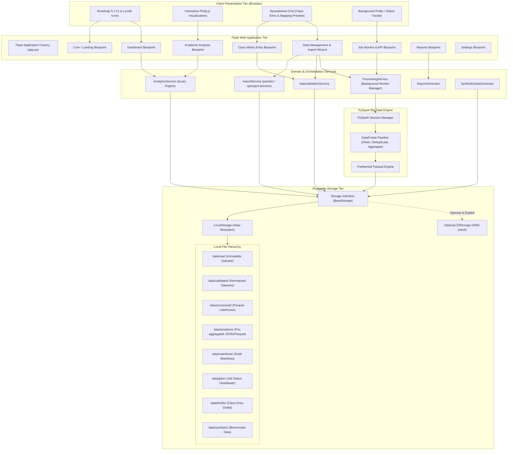
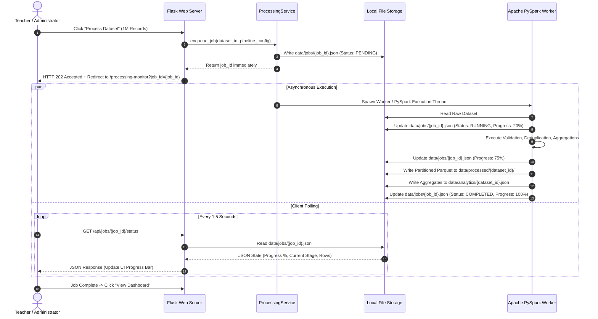

# EduPulse Analytics — System Architecture & Design Document

**Document Version:** 1.0.0  
**Status:** Architecture & Requirements Phase (Approved for Review)  
**System Name:** EduPulse Analytics  

---

## 1. Architectural Philosophy & Overview

EduPulse Analytics is designed around a **modular, local-first, decoupled Big Data architecture**. It balances the responsiveness expected of a modern web application with the heavy-lifting capabilities of Apache Spark for processing massive academic datasets ($1,000,000+$ records).

### Core Architectural Pillars
1. **Decoupled Request-Processing Cycle:** Long-running PySpark data transformation jobs are completely decoupled from Flask's synchronous WSGI HTTP worker threads via an asynchronous background job manager.
2. **File-First Storage with Clear Partitioning:** The application relies on structured, atomic, file-first storage (Parquet for columnar analytics, JSON for metadata/manifests, and CSV for interoperability).
3. **Pluggable Storage Abstraction:** A unified storage interface (`BaseStorage`) allows seamless transitions between local filesystem storage and optional, secured AWS S3 buckets without altering application logic.
4. **Strict Analytical Grounding:** The processing pipeline strictly distinguishes between numeric marks, letter grades, absent codes, and unrecorded results, preventing invalid statistical blending.

---

## 2. High-Level System Architecture Diagram



---

## 3. Component Decomposition

### 3.1 Presentation Tier (Frontend)
- **HTML5 & Jinja2 Templates:** Modular server-rendered layouts inheriting from a base template (`base.html`) providing consistent navigation, breadcrumbs, theme variables, and CSRF protection.
- **Styling & Design System:** Bootstrap 5.3 augmented with custom CSS variables for academic dashboard typography, elevation, dark/light cards, and accessible color contrast.
- **Plotly.js Visualizations:** Declarative client-side charts embedded inside responsive card containers. Visualizations include:
  - Subject score distributions (box plots and violin curves).
  - Class grade distribution histograms.
  - Multi-subject comparison radar charts.
  - Longitudinal semester performance line graphs.
  - Transparent support indicator scatter distributions.
- **Lucide Icons:** Unified vector icon library providing clear visual affordance across navigation bars, action buttons, and status badges.
- **Interactive Grid Component:** Vanilla JavaScript table component supporting spreadsheet-like navigation, cell editing, inline validation, and dynamic row/column expansion for Class Marks Entry and Import Mapping.

### 3.2 Web Application Tier (Flask)
The web tier follows the **Application Factory pattern** (`create_app()`) to guarantee testability and modularity:
- **`dashboard/routes/core.py`:** Landing page, product tour, global health checks.
- **`dashboard/routes/dashboard.py`:** Executive KPIs (total students, class pass rates, subject counts, recent import status).
- **`dashboard/routes/data_management.py`:** Dataset catalog, guided 11-step import wizard, file upload endpoints.
- **`dashboard/routes/class_entry.py`:** Interactive class marks entry grid, draft autosave, CSV export/import endpoints.
- **`dashboard/routes/student_performance.py`:** Individual student timeline, subject marks breakdown, semester progression.
- **`dashboard/routes/academic_analysis.py`:** Subject-level and department-level aggregations, pass/fail trends, and support indicators.
- **`dashboard/routes/processing_monitor.py`:** Real-time Spark batch job tracking, resource metrics, and logs.
- **`dashboard/routes/reports.py`:** Analytical report generation and downloads.
- **`dashboard/routes/settings.py`:** Academic assessment rules configuration, local storage retention, and optional AWS credentials configuration.
- **`dashboard/routes/api.py`:** RESTful JSON endpoints for asynchronous polling, schema validation, and live preview.

### 3.3 Asynchronous Job & Processing Tier
Processing $1,000,000$ records inside a standard HTTP request will inevitably result in web browser timeouts (e.g., 30-60 second gateway timeouts). EduPulse Analytics implements a dedicated, non-blocking **Processing Service**:



- **Execution Model:** A background worker pool (`concurrent.futures.ThreadPoolExecutor` or dedicated subprocess worker) isolates Spark execution from the Flask event loop.
- **Heartbeat & Telemetry:** Every stage of the PySpark pipeline reports progress (stage name, rows read, accepted, rejected, elapsed seconds) to an atomic state file: `data/jobs/{job_id}.json`.
- **Fault Recovery:** Uncaught PySpark exceptions or memory issues are caught, formatted with actionable stack traces, and written to the job state with status `FAILED`, allowing graceful UI notification without crashing the web server.

### 3.4 Big Data Engine (PySpark 3.4+)
- **Spark Local Execution Mode:** Configured for standalone single-node multi-threaded performance (`local[*]`).
- **Memory Management:** Configured via `config/settings.py` (`spark.driver.memory = "4g"`, `spark.sql.shuffle.partitions = "8"` for local multi-core optimization).
- **Native DataFrame Transformations:** All large-scale data cleaning, deduplication, type casting, validation, and analytics are implemented strictly using PySpark DataFrame operations (`pyspark.sql.functions`).
- **Strict Role for pandas:** pandas and openpyxl are utilized *exclusively* for lightweight frontend tasks: reading the first 50 rows of uploaded Excel workbooks, extracting sheet names, and validating column headers during mapping.

### 3.5 Pluggable Storage Tier
Storage is managed through an abstract base class `BaseStorage`:
- **`LocalStorage` (Default):**
  - Manages structured directories under `data/`.
  - Implements atomic writes via temporary files and `os.replace` to prevent corrupted states during concurrent reads.
  - Manages dataset manifests and job heartbeat files.
- **`S3Storage` (Optional & Explicit):**
  - Uses `boto3` to communicate with private Amazon S3 buckets.
  - Requires explicit user authorization per transfer.
  - Employs streaming multipart uploads for multi-gigabyte Parquet archives.

---

## 4. End-to-End Data Flow Architectures

### 4.1 Guided Spreadsheet Ingestion Flow

```mermaid
flowchart TD
    Start([User selects file]) --> Upload[HTTP POST /api/upload]
    Upload --> CheckExt{Check Extension & MIME<br/>CSV / XLSX / XLS}
    CheckExt -- Invalid --> ErrExt[Return 400: Unsupported Format]
    CheckExt -- Valid --> TempSave[Save to data/raw/temp_uuid.ext]

    TempSave --> Inspect[Sample Inspect: First 50 rows via pandas]
    Inspect --> DetectFormat{Heuristic Signature<br/>Marks vs Grade?}
    DetectFormat --> SuggestMapping[Detect Sheet & Candidate Headers]
    SuggestMapping --> RenderUI[Render Mapping & Preview Modal]

    RenderUI --> UserCorrects[User modifies column mapping]
    UserCorrects --> Validate[Validate Mapped Sample]
    Validate --> Tally[Compute Validation Tally:<br/>Accepted, Rejected, Duplicate, Incomplete]
    Tally --> ShowSummary[Display Validation Summary to User]

    ShowSummary --> UserConfirms{User Clicks<br/>Commit Import?}
    UserConfirms -- No / Cancel --> Cleanup[Purge Temp Upload]
    UserConfirms -- Yes --> Commit[Generate UUID & Timestamp]

    Commit --> SaveRaw[Permanently save untouched raw file:<br/>data/raw/RAW_{uuid}.ext]
    Commit --> SaveVal[Save normalized dataset:<br/>data/validated/VAL_{uuid}.csv]
    Commit --> GenManifest[Generate Cryptographic Manifest:<br/>data/manifests/MAN_{uuid}.json]
    GenManifest --> Success([Import Complete & Registered in Dataset Library])
```

### 4.2 Class Marks Entry Flow

```mermaid
flowchart TD
    OpenEntry[User navigates to /class-entry] --> LoadConfig[Load Subject Assessment Rules]
    LoadConfig --> RenderGrid[Render Editable Dynamic Grid]

    RenderGrid --> UserActions{User Interaction}
    UserActions --> AddRow[Add Student Row]
    UserActions --> EditCell[Edit Marks Cell]
    UserActions --> ModSubject[Configure Max / Passing Marks]
    UserActions --> ImportCSV[Import Existing Class Template]

    EditCell --> ClientVal[Client-Side Real-Time Validation]
    ClientVal -- Error --> HighlightCell[Highlight Red & Tooltip Warning]
    ClientVal -- OK --> ClearCell[Highlight Green]

    UserActions --> DraftAction{Save Draft?}
    DraftAction -- Yes --> SaveDraft[POST /api/class-entry/draft<br/>Write to data/drafts/{class_id}.json]
    SaveDraft --> DraftToast[Show "Draft Saved" Toast]

    UserActions --> SubmitAction{Commit Entry?}
    SubmitAction -- Yes --> PreCommitVal[Comprehensive Server Validation]
    PreCommitVal -- Failure --> ShowErrors[Display Error List Modal]
    PreCommitVal -- Passed --> ReviewModal[Display Summary Modal:<br/>Pass/Fail counts, Average, Missing]
    ReviewModal --> ConfirmCommit{Confirm?}
    ConfirmCommit -- Yes --> FinalizeEntry[Save to data/validated/ & Manifest]
    FinalizeEntry --> Done([Class Marks Dataset Created])
```

---

## 5. Storage Directory Architecture

The system utilizes a structured, deterministic file-first directory hierarchy:

```text
c:\Student Performance Analytics\data\
├── raw/                      # Immutable source files as uploaded by users
│   └── RAW_{dataset_id}.{csv|xlsx|xls}
├── validated/                # Cleaned, schema-normalized intermediate tabular records
│   └── VAL_{dataset_id}.csv
├── processed/                # Snappy-compressed, columnar Parquet dataset lake
│   └── PROC_{dataset_id}/
│       ├── _SUCCESS
│       ├── part-00000.snappy.parquet
│       └── part-00001.snappy.parquet
├── analytics/                # Pre-aggregated analytical summaries for sub-second UI queries
│   └── AGG_{dataset_id}.json
├── manifests/                # Cryptographic audit trails and mapping documentation
│   └── MAN_{dataset_id}.json
├── jobs/                     # Asynchronous job state heartbeats and progress telemetry
│   └── JOB_{job_id}.json
├── drafts/                   # In-progress editable class marks entries
│   └── DRAFT_{class_id}.json
├── reports/                  # Generated analytical executive briefings (CSV, HTML summaries)
│   └── REP_{report_id}.{csv|html}
└── synthetic/                # Generated benchmark test datasets
    └── SYNTH_{benchmark_size}_{timestamp}.csv
```

---

## 6. Concurrency, Locking & File-First Design Trade-offs

Because EduPulse Analytics prioritizes a lightweight, dependency-free deployment without mandatory PostgreSQL/MySQL setup in Phase 1, file-system concurrency must be explicitly governed:

| Architectural Concern | File-First Limitation | EduPulse Architectural Mitigation |
| :--- | :--- | :--- |
| **Atomic Writes** | Incomplete writes during sudden termination corrupt datasets. | **Write-to-Temp & Atomic Rename:** All files are written to a temporary name (e.g., `temp_xyz.tmp`) and moved to target via `os.replace` (POSIX and Windows atomic rename). |
| **Race Conditions** | Concurrent writes to the same dataset manifest. | **Dataset Immutability:** Each import creates a globally unique `dataset_id` (UUIDv4). Manifests are written once and never updated in place. |
| **Directory Scans** | Scanning thousands of manifest files can degrade UI responsiveness. | **In-Memory Registry Cache:** A lightweight manifest cache maintains dataset summaries in memory and refreshes only when filesystem timestamps change. |
| **Multi-User Isolation** | File-system lacks row-level transactions. | Phase 1 is designed for single-institution departmental analytics workstations. Clear architectural boundaries are established to allow dropping in an SQLAlchemy database adapter in future phases. |

---

## 7. Hardware & Deployment Considerations

### 7.1 Local Single-Node PySpark Architecture
- **JVM Configuration:** PySpark initializes a local JVM process. On Windows systems, winutils/Hadoop binary dependencies must be handled cleanly via bundled environment settings or Apache Spark 3.3+ native POSIX shims.
- **Garbage Collection & RAM Allocation:** 
  - For $100,000$ records: Default Python/Spark memory ($1\text{ GB}$) is sufficient.
  - For $1,000,000$ records: Spark driver memory must be configured to at least $4\text{ GB}$ (`SPARK_DRIVER_MEMORY=4g`).
  - Disk Spillover: Spark temporary spill directories are routed to `data/temp/spark_scratch/` to prevent filling system drive roots.
- **CPU Parallelism:** Default local parallelism matches available physical CPU cores (`local[*]`), guaranteeing full hardware utilization during distributed aggregations.
