# EduPulse Analytics — Phased Implementation Roadmap

**Document Version:** 1.0.0  
**Status:** Architecture & Requirements Phase (Approved for Review)  
**System Name:** EduPulse Analytics  

---

## 1. Roadmap Overview & Phasing Principles

EduPulse Analytics follows a **gated, incremental engineering methodology**. Each phase produces verified, tested deliverables before the next phase begins.

> [!IMPORTANT]
> **No Premature Implementation:** Phases 1 through 9 are executed sequentially only after explicit approval of the preceding stage. Phase 9 (AWS Integration) requires an independent, dedicated authorization gate.

```mermaid
graph LR
    P1["Phase 1:<br/>Skeleton & Config"] --> P2["Phase 2:<br/>Import & Storage"]
    P2 --> P3["Phase 3:<br/>Class Marks Entry"]
    P3 --> P4["Phase 4:<br/>Grade Results & SGPA"]
    P4 --> P5["Phase 5:<br/>Synthetic & PySpark"]
    P5 --> P6["Phase 6:<br/>Analytics & UI"]
    P6 --> P7["Phase 7:<br/>Reports & Monitor"]
    P7 --> P8["Phase 8:<br/>Tests & Benchmarks"]
    P8 -.->|Explicit Cloud Gate| P9["Phase 9:<br/>Optional AWS S3"]
```

---

## 2. Phase-by-Phase Execution Plan

### Phase 1: Project Skeleton, Configuration & Web Baseline
- **Deliverables:**
  - Project directory structure (`config/`, `dashboard/`, `src/`, `storage/`, `services/`, `data/`, `tests/`).
  - Core configuration engine (`config/settings.py` loading `.env` safely).
  - Assessment rule dictionary defaults (`config/assessment_rules.py`).
  - Base Flask application factory (`create_app`) with logging setup and basic landing page route (`/`).
  - Base Jinja2 layout (`base.html`), Bootstrap 5.3 integration, custom CSS palette, and Lucide icons.
- **Verification Gate:**
  - `python app.py` starts cleanly without warnings.
  - Landing page renders correctly with zero console errors.
  - Logging outputs to `logs/edupulse.log` with student data masking filters active.

---

### Phase 2: Local Storage Engine & Guided Import Wizard
- **Deliverables:**
  - Local storage service (`storage/local_storage.py`) with atomic file write semantics.
  - File upload and format detection engine (`src/import_service.py`).
  - 11-step import wizard UI (`dashboard/templates/import_wizard.html`).
  - Column candidate profiling and fuzzy auto-mapper.
  - Pre-commit validation engine (`src/data_validation.py`) and summary scorecard.
  - Cryptographic JSON Import Manifest generator (`data/manifests/`).
- **Verification Gate:**
  - Upload sample CSV and multi-sheet XLSX.
  - Successfully map non-standard columns (e.g., `USN` $\rightarrow$ `student_id`).
  - Verify original file remains unmodified in `data/raw/` and normalized CSV is saved in `data/validated/`.
  - Validate manifest creation against JSON schema.

---

### Phase 3: Class Marks Entry & Assessment Rules Engine
- **Deliverables:**
  - Interactive, editable spreadsheet table for class-wise marks (`/class-entry`).
  - Real-time client-side validation for out-of-range marks.
  - Dynamic subject column addition and max marks configuration.
  - Draft autosave and load endpoints (`data/drafts/`).
  - Bidirectional CSV template export and import.
  - Pre-commit summary review modal.
- **Verification Gate:**
  - Enter marks for 30 students across 4 subjects directly in browser.
  - Trigger validation errors for negative marks and scores exceeding limits.
  - Save draft, refresh browser, and verify draft state is restored.
  - Commit class marks into `data/validated/` with manifest.

---

### Phase 4: Grade-Based Result Imports & SGPA Analysis
- **Deliverables:**
  - Grade sheet parser for university-style results (`src/grade_service.py`).
  - Canonical status classifier distinguishing `PASSED`, `FAILED`, `ABSENT`, `WITHHELD`, and `MISSING`.
  - Configurable university grade scales (`O=10, A+=9, A=8, B+=7, B=6, C=5, P=4, F=0`).
  - Official SGPA ingestion and validation.
  - Guardrails prohibiting arbitrary grade-to-marks conversions.
- **Verification Gate:**
  - Ingest university result sheet with letter grades and `Ab` codes.
  - Verify `Ab` is preserved as absent (not converted to 0 or fail).
  - Verify blank cells are flagged as unrecorded (not auto-failed).
  - Verify SGPA metrics match institutional calculations.

---

### Phase 5: Synthetic Big Data Engine & PySpark Batch Pipeline
- **Deliverables:**
  - Synthetic Big Data Generator (`src/data_generator.py`) capable of streaming 10k, 100k, 500k, and 1,000,000+ records.
  - Fictional student identity generator (`STU-YYYY-XXXXX`) with reproducible random seeds.
  - PySpark session manager and DataFrame batch pipeline (`src/spark_processing.py`).
  - PySpark transformations: schema casting, windowed deduplication, range validation, aggregation.
  - Snappy-compressed partitioned Parquet writer (`data/processed/`).
  - Background Job Service (`services/processing_service.py`) with non-blocking thread/process execution and JSON status heartbeats (`data/jobs/`).
- **Verification Gate:**
  - Generate 1,000,000 synthetic records without Python memory exhaustion.
  - Launch PySpark batch job from web UI; verify Flask server remains responsive.
  - Parquet dataset written with `_SUCCESS` marker and valid partitions.
  - Verify execution time, rows processed, and throughput metrics.

---

### Phase 6: Core Analytics Services & Interactive Dashboard
- **Deliverables:**
  - Academic analytics query service (`src/analytics.py` and `services/analytics_service.py`).
  - Executive institutional dashboard (`/dashboard`) with key metric cards.
  - Academic analysis view (`/academic-analysis`) with subject, semester, and department drill-downs.
  - Student performance trajectory view (`/student-performance`).
  - Interactive Plotly.js charts: distribution curves, radar charts, grade histograms, pass/fail trends.
  - Transparent, rule-based Student Support Indicators with human-readable explanations.
  - Empty-state illustrations and onboarding guides for new deployments.
- **Verification Gate:**
  - Dashboard loads instantaneously ($< 500\text{ ms}$) using pre-aggregated metadata.
  - Plotly charts render smoothly and react to semester/department filters.
  - Support indicators explain exact rules triggered (no opaque black-box claims).

---

### Phase 7: Reports, Job Monitoring & UX Polish
- **Deliverables:**
  - Real-time Spark job monitoring page (`/processing-monitor`) with progress bars, stage status, and logs.
  - Report generator (`src/report_generator.py`) producing downloadable CSV and HTML executive briefings (`/reports`).
  - Global settings manager (`/settings`) for assessment criteria and storage policies.
  - WCAG 2.1 AA accessibility audit: color contrast, keyboard focus rings, screen reader labels.
  - Lightweight landing page hero animations with `prefers-reduced-motion` compliance.
- **Verification Gate:**
  - Monitor live job progress from 0% to 100% with real-time UI updates.
  - Generate and download clean executive report.
  - Verify keyboard accessibility and responsive mobile layout.

---

### Phase 8: Comprehensive Automated Testing & Benchmarking
- **Deliverables:**
  - Complete `pytest` test suite covering unit, ingestion, Spark, web routes, and storage.
  - Ground-truth mathematical test fixtures with expected metric outputs.
  - Formal scale benchmark report documenting execution duration, RAM footprint, and disk sizes across 10k, 100k, 500k, and 1,000,000 records.
  - Reproducible setup and execution guide in `README.md`.
- **Verification Gate:**
  - 100% of unit and integration tests pass.
  - Empirical benchmark completed on single local machine with honest telemetry.

---

### Phase 9: Optional AWS S3 Integration (Subject to Separate Approval)
- **Deliverables:**
  - S3 cloud storage adapter (`storage/s3_storage.py`) utilizing `boto3`.
  - Interactive Cloud Sync modal with pre-upload payload breakdown, cost estimation, and confirmation token.
  - Mocked test suite using `moto` (zero AWS charges incurred).
- **Verification Gate:**
  - S3 adapter passes all `moto` unit tests.
  - Application functions completely when AWS is disabled (`AWS_ENABLED=false`).
  - Upload to actual S3 bucket executed only upon explicit user command with verified credentials.

---

## 3. Definition of Done (Demonstration Readiness Checklist)

The project will be certified as complete and ready for academic demonstration when:
- [ ] Both marks-based and grade-based academic records are fully supported.
- [ ] University result sheets can be mapped and ingested without hardcoding structural layout.
- [ ] Assessment rules, passing cutoffs, and grade scales are configurable and documented.
- [ ] At least 1,000,000 synthetic academic records can be generated and processed with PySpark on local hardware.
- [ ] Real benchmark performance metrics (time, RAM, throughput) are honestly measured and reported.
- [ ] Dashboard cards and Plotly charts are dynamically derived from processed data.
- [ ] Imports preserve raw uploaded files and record auditable cryptographic JSON manifests.
- [ ] Heavy Spark processing runs asynchronously without blocking web navigation.
- [ ] System operates out of the box locally without requiring AWS credentials or external databases.
- [ ] Cloud synchronization requires explicit user confirmation and cost warnings.
- [ ] Comprehensive automated test suite passes reproducibly.
- [ ] Zero real student identifiers or credentials are committed to version control.
