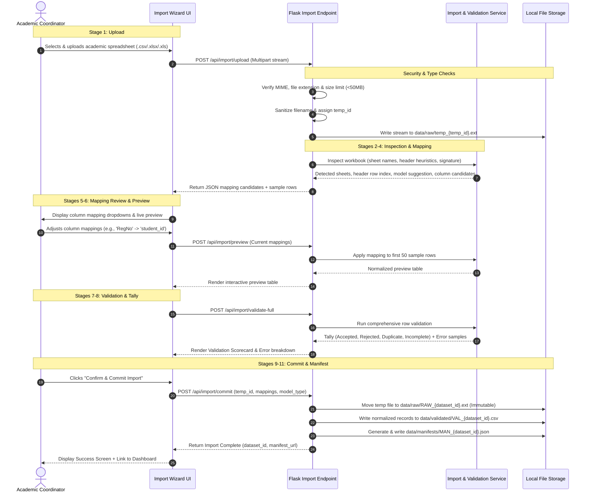

# EduPulse Analytics — Guided Spreadsheet Import Workflow

**Document Version:** 1.0.0  
**Status:** Architecture & Requirements Phase (Approved for Review)  
**System Name:** EduPulse Analytics  

---

## 1. Import Workflow Objectives

Academic spreadsheets collected from faculty departments or downloaded from university examination portals often suffer from structural unpredictability: merged header rows, metadata prefixes, inconsistent column labels, formula references, and blank rows.

The EduPulse **11-Stage Guided Import Workflow** ensures:
1. **Zero Data Loss:** Source files are permanently retained in their exact uploaded byte sequence.
2. **Untrusted Input Defense:** Rigorous protection against formula injection, zip bombs, and path traversal.
3. **Transparent Auditing:** Every mapping decision, validation failure, and accepted row count is formally recorded in an immutable JSON manifest.
4. **Privacy First:** Real student identities and complete IDs are masked in audit logs and omitted from analytical datasets.

---

## 2. The 11-Stage Ingestion Pipeline

---

## 3. Step-by-Step Technical Execution

### Stage 1: Secure Upload & MIME Validation
- **Client-Side:** Enforces extension filtering (`.csv`, `.xlsx`, `.xls`) and checks client-side file size ($< 50\text{ MB}$).
- **Server-Side Verification:**
  - Validates magic bytes / MIME types (`text/csv`, `application/vnd.openxmlformats-officedocument.spreadsheetml.sheet`, `application/vnd.ms-excel`).
  - Generates a collision-free temporary storage identifier (`temp_` + UUIDv4).
  - Sanitizes filename via `werkzeug.utils.secure_filename`.

### Stage 2: Format Classification Suggestion
The backend scans the first $20$ rows of the file to determine the academic data model:
- **Marks-Based Signature:** Presence of terms such as `internal`, `external`, `total`, `max`, `marks`, `theory`, `practical`.
- **Grade-Based Signature:** Presence of terms such as `grade`, `letter`, `sgpa`, `cgpa`, `credit`, `o, a+, a, b, c, f`, `ab`.
- **User Override:** The suggested model is highlighted, but the user may toggle between *Marks-Based* and *Grade-Based* formats.

### Stage 3: Sheet Selection & Header Row Auto-Discovery
- **Multi-Sheet Detection:** For `.xlsx` and `.xls` files, all worksheet names are listed. The user selects which sheet to import.
- **Header Heuristic:** University sheets often place 3 to 10 rows of institutional branding (e.g., *"XYZ University - Semester Examination Results"*) before the actual column titles. The algorithm evaluates rows $0$ to $15$ for string density, absence of numbers, and presence of standard academic keywords (`roll`, `reg`, `sub`, `code`) to identify the probable header row.

### Stage 4: Column Candidate Profiling & Auto-Mapping
The system executes fuzzy string matching and regex pattern profiling against canonical schema attributes:
- **`student_id` Candidates:** Match headers like `Roll No`, `Reg No`, `USN`, `HT No`, `Student ID`, `Enrollment No`.
- **`subject_code` Candidates:** Match headers like `Sub Code`, `Course Code`, `Paper Code`, `Subject`.
- **`internal_marks` Candidates:** Match headers like `CIA`, `Internal`, `Int`, `Sessional`, `Midterm`.
- **`external_marks` Candidates:** Match headers like `ESE`, `External`, `Ext`, `End Sem`, `Theory`.
- **`grade` Candidates:** Match headers like `Grade`, `Letter Grade`, `LG`, `Result`.
- **`sgpa` Candidates:** Match headers like `SGPA`, `GPA`, `SPI`, `Semester GPA`.

### Stage 5: Interactive User Review & Correction
The user interface renders an intuitive mapping matrix:
- Left column: Source spreadsheet header.
- Center: Auto-detected canonical destination field with a confidence badge (High / Medium / Low).
- Right: Dropdown allowing faculty to reassign, map to an ignored column, or define custom subject code associations.

### Stage 6: Live Mapped Preview
Before running heavy validation, a paginated preview displaying the first $50$ rows transformed according to the user's mapping is rendered in the UI. This provides immediate visual reassurance that columns are not transposed.

### Stage 7: Comprehensive Pre-Commit Validation
Validation rules are executed row-by-row:
1. **Mandatory Field Rule:** `student_id` and subject identifiers must be present and non-blank.
2. **Numeric Range Rule (Marks):** $0 \le \text{internal} \le \text{max\_internal}$, $0 \le \text{external} \le \text{max\_external}$.
3. **Grade Vocabulary Rule (Grades):** Letter grades must strictly adhere to the configured university grade set (`O, A+, A, B+, B, C, P, F, Ab, W`).
4. **Duplicate Record Rule:** Records matching an identical composite key (`student_id + subject_code + semester`) within the same import are flagged as duplicates.
5. **Data Completeness Rule:** Missing fields (e.g., student ID present but external mark blank without an absent code) are flagged as incomplete.

### Stage 8: Validation Tally Dashboard
A validation scorecard presents transparent tallies:
- **Total Rows Read:** $N_{\text{total}}$
- **Accepted Rows:** $N_{\text{accepted}}$ (Passed all checks; ready for commit)
- **Rejected Rows:** $N_{\text{rejected}}$ (Violated fatal constraints, e.g., missing student ID or corrupted characters)
- **Duplicate Rows:** $N_{\text{duplicate}}$ (Multiple records for same student-subject pair)
- **Incomplete Rows:** $N_{\text{incomplete}}$ (Missing optional scores or flagged for administrative review)
- **Actionable Error Inspector:** An expandable drawer displays specific row numbers and human-readable failure causes (e.g., `Row 42: External mark 105 exceeds maximum limit 100`).

### Stage 9: Explicit Confirmation Gate
The user must explicitly click a **"Confirm & Commit Import"** button. The system displays a warning summary if rejected or duplicate rows exist:
> *"12 rows contain fatal errors and will not be imported. Proceed with importing 4,988 valid records?"*

### Stage 10: Segregated Storage Write
Upon confirmation:
1. The temporary upload file is renamed and permanently moved to:  
   `data/raw/RAW_{dataset_id}.{csv|xlsx|xls}` (Read-only attribute applied).
2. The cleaned, normalized records are saved as an intermediate standardized tabular dataset:  
   `data/validated/VAL_{dataset_id}.csv`.

### Stage 11: Import Manifest Generation
The system constructs a signed, immutable JSON manifest file:  
`data/manifests/MAN_{dataset_id}.json` capturing all metadata, checksums, mapping tables, and validation logs (see schema in [data_model.md](file:///c:/Student%20Performance%20Analytics/docs/data_model.md)).

---

## 4. Untrusted File Handling & Threat Mitigations

### 4.1 Excel / CSV Formula Injection (CWE-1236)
- **The Threat:** Attackers or rogue students embed formulas such as `=CMD|' /C calc'!A0` or `=HYPERLINK("http://attacker.com", "Click")` in name or remark fields. When an administrator later exports this data to Excel, the formula executes locally.
- **The Mitigation:** During normalization, every text cell beginning with sensitive prefix characters (`=`, `+`, `-`, `@`, `\t`, `\r`) is safely prepended with a single quote (`'`), disabling formula execution while preserving visual text.

### 4.2 Malformed Workbooks & Zip Bomb Defenses
- **The Threat:** Craftily compressed Excel files (`.xlsx` is a PKZIP archive) expanding to hundreds of gigabytes in memory during XML parsing.
- **The Mitigation:**
  - File size cap strictly enforced at $50\text{ MB}$ at web gateway and stream reader.
  - Safe openpyxl configuration: `read_only=True` mode, strictly preventing full DOM tree loading.
  - Formula evaluation is explicitly disabled (`data_only=True`), preventing macro or code execution during spreadsheet parsing.

### 4.3 Path Traversal Prevention
- **The Threat:** Filenames containing `../../../../windows/system32/cmd.exe`.
- **The Mitigation:** Original filenames are recorded purely as string metadata inside the JSON manifest. Physical files stored on disk are strictly renamed using internal deterministic UUIDv4 strings (`RAW_550e8400-e29b-41d4-a716-446655440000.xlsx`).

---

## 5. Privacy Protections During Ingestion

1. **Zero Logging of Real Student Records:** Application server logs (`logs/edupulse.log`) are strictly prohibited from printing complete raw CSV rows, real student names, or full student registration numbers.
2. **Student ID Masking:** When student IDs appear in validation warnings or manifest audit logs, they are masked automatically (e.g., `21CS042` $\rightarrow$ `21***42`).
3. **Isolation of Public Static Files:** Upload directories (`data/raw/`, `data/validated/`) are stored outside Flask's `dashboard/static/` directory tree, ensuring uploaded spreadsheets can never be accessed via direct HTTP URL requests.

---

## 6. Universal Academic Assessment Import Engine & Root Cause Analysis

### 6.1 Root Cause of Previous Importer Failure
During initial implementations, importing internal marks workbooks caused a severe defect where the engine retained only student IDs and dropped all subject marks. Detailed root cause analysis revealed:

1. **Strict 1:1 Column Mapping Expectation:** The original `ImportService` assumed spreadsheets were already in a single-row-per-subject format with predefined canonical columns (`internal_marks`, `external_marks`, `subject_code`).
2. **Heuristic Keyword Failure on Wide Spreadsheets:** In real academic institutions, spreadsheets are wide matrices where each subject is a separate column (e.g., `20CS32001-IoT`, `Mathematics`, `Physics`). The matching heuristic searched only for `internal_marks` and `external_marks` keywords, which did not match subject names. Only the student roll number column was matched.
3. **Pruning of Unmapped Columns:** In `generate_preview`, the engine pruned any column not present in the mapping table (`preview_df = preview_df[mapped_cols]`). Consequently, all subject mark columns were discarded.
4. **Validation Pipeline Fallback:** In `DataValidationService.validate_marks_records`, the engine called `row.get("internal_marks")`. Because subject columns were stripped, both internal and external marks were `None`. The evaluator marked the row `INCOMPLETE`, defaulted `subject_code` to `"DEFAULT"`, and persisted empty records containing only `student_id`.
5. **No Unpivoting Engine:** The importer lacked an automated wide-to-long melt transformation to transpose horizontal subject mark grids into canonical academic assessment records.
6. **Banner Row & Serial Number Traps:** Institutional title banners (3-5 header rows) and serial number columns (`S.No`) threw off header detection and caused serial numbers to be mistaken for student IDs.

### 6.2 Architectural Solution: Universal Ingestion Pipeline
The Universal Academic Assessment Import Engine resolves these issues with:
- **Layout Auto-Detection:** Dynamically analyzes column structures to detect Wide matrices vs. Long tabular formats.
- **Smart Banner Detection:** Scans the first 25 rows, identifying and extracting institutional banners (e.g., college names, examination notices) while pinning the genuine table header.
- **Serial Number Filtering:** Distinguishes `S.No` / `Sl.No` from student identifiers (`HT No`, `Roll No`, `USN`).
- **Roll Number String Integrity:** Reads all cells as pure strings (`dtype=str`) so leading zeroes (e.g., `00101`, `09A11A0501`) and alphanumeric IDs are never corrupted by float conversion or scientific notation.
- **Wide-to-Long Normalization:** Melts wide subject columns into canonical records with subject codes, subject names, assessment types, and marks/grades.
- **Cell-Level Error Tolerance:** Validates individual student-subject assessment records independently, ensuring a single anomalous cell does not reject a student's remaining valid marks.
- **Assessment Categorization:** Supports Semester Exams, Mid-1, Mid-2, Internal Assessments, Labs, Practicals, Assignments, Quizzes, Projects, and Vivas.

