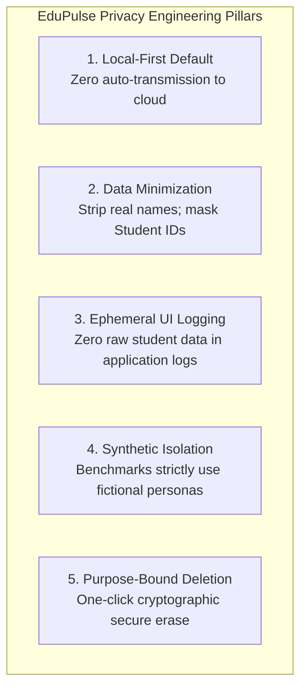
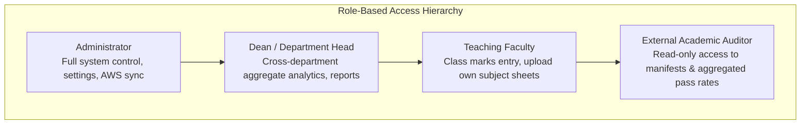

# EduPulse Analytics — Privacy & Security Architecture

**Document Version:** 1.0.0  
**Status:** Architecture & Requirements Phase (Approved for Review)  
**System Name:** EduPulse Analytics  

---

## 1. Academic Data Confidentiality & Governance

Academic records represent sensitive institutional and personal data. A student's academic standing, exam marks, failure history, and attendance records are confidential under global privacy frameworks including:
- **FERPA (Family Educational Rights and Privacy Act):** Safeguarding student education records.
- **GDPR (General Data Protection Regulation):** Personal data minimization, purpose limitation, and storage limitation.
- **Digital Personal Data Protection (DPDP) Act:** Duty of educational institutions to protect student data from unauthorized disclosure and ensure strict purpose specification.

EduPulse Analytics adopts a **Zero-Trust, Local-First, Privacy-Preserving** architecture ensuring that academic data remains strictly under institutional control.

---

## 2. Privacy Engineering Principles



### 2.1 Local-First Confinement
- **Zero Automated Telemetry:** The application contains zero third-party analytics trackers, telemetry beacons, or external web fonts.
- **Air-Gapped Operation:** All core services—including PySpark processing, data validation, charting, and report compilation—function with 100% feature parity on air-gapped, isolated internal college networks without internet connectivity.

### 2.2 Data Minimization & Pseudonymization
- **Exclusion of Real Student Names:** Real student names are not required for analytical grouping (averages, distributions, difficulty indices, SGPA trends). Analytical Parquet files and aggregation summaries store only pseudonymized or masked identifiers.
- **Masking Strategy:**
  - *Raw Upload:* Preserved unmodified in `data/raw/` for institutional audit.
  - *Analytical Layer:* Student IDs are masked:
    $$\text{Mask}(\text{"21BCSE0421"}) \rightarrow \text{"21***0421"}$$
  - *Synthetic Engine:* Synthetic datasets use exclusively procedural synthetic tokens: `STU-2026-00001` through `STU-2026-99999`. Real student rosters are never used as seeds.

### 2.3 Strict Application Logging Policy
Application logs (`logs/edupulse.log`) are configured via Python's standard `logging` library with custom filters:
- **Prohibited in Logs:** Complete student roll numbers, student names, individual test marks, SGPA numbers, and raw CSV row contents.
- **Permitted in Logs:** Timestamp, event name, execution duration, dataset UUID, aggregated counts (e.g., `rows_processed=50000`, `rejected_count=12`), and system exception class names.

---

## 3. Threat Modeling & Countermeasures

| Threat Vector | Attack Scenario | Impact | EduPulse Architectural Countermeasure |
| :--- | :--- | :--- | :--- |
| **Path Traversal (CWE-22)** | Attacker uploads file named `../../../../etc/passwd` or accesses `GET /reports?file=../../app.py`. | Unauthorized file disclosure or file overwriting. | 1. Input sanitization via `werkzeug.utils.secure_filename`.<br/>2. Physical files named strictly by UUIDv4 (`RAW_{uuid}.csv`).<br/>3. File resolution strictly anchored to `DATA_DIR` with `os.path.commonpath` verification. |
| **CSV / Formula Injection (CWE-1236)** | Student enters `=CMD\|' /C calc'!A0` in text entry or CSV upload. Admin exports report to Excel. | Remote code execution on administrator's desktop. | Every text field exported to CSV or displayed is sanitized: any leading character in `['=', '+', '-', '@', '\t', '\r']` is prefixed with `'` (single quote). |
| **Zip Bomb / XML Entity Expansion (CWE-400)** | Attacker uploads a 20KB `.xlsx` file that expands into a 100GB XML DOM in memory. | System Out-Of-Memory (OOM) crash, denial of service (DoS). | 1. Hard upload limit of $50\text{ MB}$ enforced at WSGI gateway.<br/>2. `openpyxl` configured with `read_only=True` (streaming SAX parser; no DOM expansion). |
| **Public Static File Leakage (CWE-552)** | Web server serves `data/raw/` via public HTTP static handler. Anyone can download raw exams. | Catastrophic privacy breach. | Data directory (`data/`) is located strictly outside Flask's static folder (`dashboard/static/`). Access to files requires authenticated route handlers. |
| **Credential & Secret Exposure (CWE-522)** | AWS keys, Flask secret keys, or database credentials committed to Git. | Cloud compromise or session hijacking. | 1. `.gitignore` explicitly bans `.env`, `data/`, `logs/`, `*.pem`, `*.key`.<br/>2. `config/settings.py` enforces runtime loading from environment variables.<br/>3. Default fallbacks refuse to use production AWS credentials without explicit flags. |

---

## 4. Secure File Access & Storage Sandbox

EduPulse implements a **Safe Path Verification Utility** across all file-handling services:

```python
import os
from pathlib import Path

def resolve_safe_path(base_dir: str, requested_filename: str) -> Path:
    """
    Guarantees that requested_filename resolves strictly inside base_dir,
    preventing relative path traversal and symbolic link escapes.
    """
    base = Path(base_dir).resolve()
    target = (base / requested_filename).resolve()
    
    # Assert target is strictly inside base directory
    if not str(target).startswith(str(base)):
        raise PermissionError(f"Security Alert: Directory traversal detected for path: {requested_filename}")
        
    return target
```

---

## 5. Role-Based Access Control (RBAC) Blueprint

For future remote or multi-user departmental deployments, EduPulse defines four strict role boundaries:



| Action / Capability | Administrator | Dean / Dept Head | Teaching Faculty | Auditor |
| :--- | :---: | :---: | :---: | :---: |
| View Institution Dashboard | Yes | Yes | Own Dept Only | Aggregates Only |
| Upload & Map Spreadsheets | Yes | Yes | Own Subjects Only | No |
| Class Marks Entry & Drafts | Yes | Yes | Own Class Only | No |
| Trigger Million-Record Spark Pipeline | Yes | Yes | No | No |
| Download Executive Reports | Yes | Yes | Own Class Only | Yes |
| Configure Assessment Rules | Yes | No | No | No |
| AWS Cloud Archive Sync | Yes | No | No | No |
| Delete Datasets & Purge Storage | Yes | No | No | No |

---

## 6. Retention, Backups & Secure Deletion

1. **Dataset Lifecycle States:**
   - `DRAFT`: Temporary class marks entry in progress; auto-purged after 30 days of inactivity.
   - `ACTIVE`: Registered dataset active in analytical dashboards.
   - `ARCHIVED`: Dataset preserved for historical audits; excluded from active query indexing.
   - `PURGED`: Permanently deleted.
2. **Cryptographic Secure Deletion:**
   When an administrator selects "Delete Dataset":
   - Raw file (`data/raw/RAW_{id}.*`), validated file (`data/validated/VAL_{id}.*`), and processed Parquet directories (`data/processed/PROC_{id}/`) are deleted from the disk.
   - The deletion event is recorded in a tamper-evident audit manifest (`data/manifests/TOMBSTONE_{id}.json`) recording who initiated deletion and the deletion timestamp.
   - Zero remnants remain in temporary swap directories.
