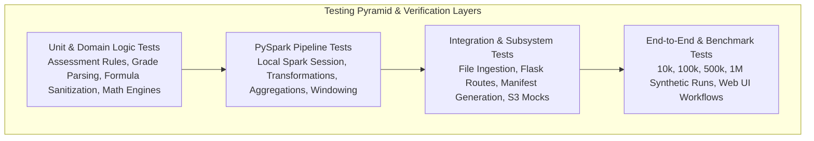

# EduPulse Analytics — Comprehensive Testing Strategy

**Document Version:** 1.0.0  
**Status:** Architecture & Requirements Phase (Approved for Review)  
**System Name:** EduPulse Analytics  

---

## 1. Testing Philosophy & Test Pyramid

EduPulse Analytics adopts a multi-tiered test pyramid ensuring that every layer—from granular assessment mathematical formulas to distributed million-record PySpark pipelines—is verified through automated, reproducible test suites.



---

## 2. Test Suite Categorization

| Tier | Focus Area | Framework / Tool | Mocking / Dependencies | Execution Target |
| :--- | :--- | :--- | :--- | :--- |
| **Unit** | Assessment rules, passing cutoffs, grade mapping, status enum preservation, formula sanitization. | `pytest` | Pure in-memory fixtures; zero I/O. | $< 5\text{ seconds}$ |
| **Ingestion** | CSV, XLSX, and XLS parsing, multi-line header heuristics, column mapper algorithms. | `pytest`, `openpyxl`, `pandas` | Synthetic test spreadsheets (50 rows). | $< 10\text{ seconds}$ |
| **PySpark Engine** | Native DataFrame cleaning, deduplication, derived calculations, Parquet writes. | `pytest`, `pyspark` (local mode) | Local Spark session fixture (`local[2]`). | $< 30\text{ seconds}$ |
| **Web Integration** | Flask routes, form submissions, asynchronous job polling endpoints, error handling. | `pytest`, Flask test client | Local filesystem sandbox (`tests/sandbox/`). | $< 15\text{ seconds}$ |
| **Storage & Manifest** | Atomic file writes, UUID collisions, SHA-256 checksums, JSON Schema validation. | `pytest`, `jsonschema` | Temporary directories (`tempfile`). | $< 5\text{ seconds}$ |
| **Cloud Adapter** | S3 bucket upload, download, permission errors, retry logic. | `pytest`, `moto` | `mock_aws` in-memory mock; zero AWS calls. | $< 5\text{ seconds}$ |
| **Scale Benchmarks** | Big data performance on 10k, 100k, 500k, 1M+ records; RAM and execution profiling. | Custom benchmark runner | PySpark standalone on test workstation. | Scheduled / Manual |

---

## 3. Deterministic Ground-Truth Test Fixtures

To ensure mathematical precision, tests rely on deterministic fixtures with known ground truth:

### 3.1 Marks-Based Ground-Truth Fixture (`fixture_marks_class.csv`)
- **Dataset Properties:** Exactly 10 student records for Subject `CS201` (Max Internal: 40, Max External: 60, Pass Internal: 16, Pass External: 24, Pass Total: 40).

| Student ID | Internal (40) | External (60) | Expected Total | Expected Status | Notes |
| :--- | :---: | :---: | :---: | :---: | :--- |
| `STU001` | 36.0 | 54.0 | 90.0 | `PASS` | High Distinction |
| `STU002` | 28.0 | 42.0 | 70.0 | `PASS` | First Class |
| `STU003` | 18.0 | 26.0 | 44.0 | `PASS` | Borderline Pass |
| `STU004` | 14.0 | 30.0 | 44.0 | `FAIL` | Internal below cutoff ($14 < 16$) |
| `STU005` | 24.0 | 18.0 | 42.0 | `FAIL` | External below cutoff ($18 < 24$) |
| `STU006` | 15.0 | 20.0 | 35.0 | `FAIL` | Total below aggregate cutoff ($35 < 40$) |
| `STU007` | 0.0 | 0.0 | 0.0 | `FAIL` | Scored Zero |
| `STU008` | `NULL` | 40.0 | `NULL` | `INCOMPLETE` | Missing Internal Score |
| `STU009` | 30.0 | `Ab` | 30.0 | `ABSENT` | Absent for External Exam |
| `STU010` | 25.0 | 35.0 | 60.0 | `WITHHELD` | Administrative Hold |

#### Expected Analytical Metrics:
- **Total Valid Records Evaluated for Pass Rate:** 7 (Excludes `INCOMPLETE`, `ABSENT`, `WITHHELD`)
- **Pass Count:** 3 (`STU001`, `STU002`, `STU003`)
- **Fail Count:** 4 (`STU004`, `STU005`, `STU006`, `STU007`)
- **Pass Percentage:** $3 / 7 = 42.86\%$
- **Average Total Marks (Evaluated):** $(90 + 70 + 44 + 44 + 42 + 35 + 0) / 7 = 46.43$
- **Median Total Marks:** $44.0$

### 3.2 Grade-Based Ground-Truth Fixture (`fixture_grades_sheet.xlsx`)
- **Dataset Properties:** University result sheet with 8 records.

| Student ID | Subject | Letter Grade | Expected Status | Grade Point | Course Credits |
| :--- | :--- | :--- | :--- | :---: | :---: |
| `STU101` | `MA101` | `O` | `PASSED` | 10.0 | 4.0 |
| `STU101` | `PH101` | `A+` | `PASSED` | 9.0 | 4.0 |
| `STU102` | `MA101` | `B` | `PASSED` | 7.0 | 4.0 |
| `STU102` | `PH101` | `F` | `FAILED` | 0.0 | 4.0 |
| `STU103` | `MA101` | `Ab` | `ABSENT` | `NULL` | 4.0 |
| `STU103` | `PH101` | `A` | `PASSED` | 8.0 | 4.0 |
| `STU104` | `MA101` | `W` | `WITHHELD` | `NULL` | 4.0 |
| `STU104` | `PH101` | *(blank)* | `MISSING` | `NULL` | 4.0 |

#### Expected Analytical Metrics:
- **`STU101` Official SGPA:** $(4 \times 10 + 4 \times 9) / (4 + 4) = 76 / 8 = 9.50$
- **`STU102` Official SGPA:** $(4 \times 7 + 4 \times 0) / (4 + 4) = 28 / 8 = 3.50$
- **Total Course Pass Rate:** $4 \text{ PASSED} / 5 \text{ Resolved} = 80.0\%$ (Fails=1, Passed=4; Absents & Withheld excluded from direct pass ratio).

---

## 4. PySpark Distributed Pipeline Test Fixtures

Testing PySpark DataFrame transformations requires a shared session fixture defined in `tests/conftest.py`:

```python
import pytest
from pyspark.sql import SparkSession

@pytest.fixture(scope="session")
def spark_session():
    """Provides a shared local PySpark session optimized for fast test execution."""
    spark = SparkSession.builder \
        .appName("EduPulse-Test-Suite") \
        .master("local[2]") \
        .config("spark.ui.enabled", "false") \
        .config("spark.sql.shuffle.partitions", "2") \
        .config("spark.default.parallelism", "2") \
        .getOrCreate()
    yield spark
    spark.stop()
```

---

## 5. Security & Privacy Test Cases

1. **Formula Injection Sanitization Test:**
   - Input: `=HYPERLINK("evil.com", "Click")` in Student Name or Remarks.
   - Assert: Stored output begins with `'=HYPERLINK...` ensuring Excel treats it as literal text.
2. **Path Traversal Escape Test:**
   - Input: `../../../../etc/passwd` passed to dataset viewer or report downloader.
   - Assert: System raises `PermissionError` or returns HTTP 400; no directory traversal succeeds.
3. **Student ID Logging Scrubbing Test:**
   - Execute an end-to-end import of 500 rows.
   - Inspect `logs/edupulse.log`.
   - Assert: No full student IDs or raw row strings exist in the log file; masked forms (`STU***01`) only.
4. **AWS Upload Confirmation Gate Test:**
   - Assert: Directly invoking the S3 sync endpoint without the confirmation token returns HTTP 403 Forbidden.

---

## 6. Performance Benchmarking Protocol

Scale benchmark testing validates processing stability and hardware utilization across four target scales:

| Scale Tier | Record Count | Approximate Raw Size | Expected Gen Time | Target PySpark Processing Time | Target Memory Usage |
| :---: | :---: | :---: | :---: | :---: | :---: |
| **Tier 1** | $10,000$ | $\sim 1\text{ MB}$ | $< 1\text{ s}$ | $< 3\text{ s}$ | $< 500\text{ MB}$ |
| **Tier 2** | $100,000$ | $\sim 12\text{ MB}$ | $< 5\text{ s}$ | $< 10\text{ s}$ | $< 1.2\text{ GB}$ |
| **Tier 3** | $500,000$ | $\sim 60\text{ MB}$ | $< 25\text{ s}$ | $< 35\text{ s}$ | $< 2.5\text{ GB}$ |
| **Tier 4** | $1,000,000+$ | $\sim 120\text{ MB}$ | $< 50\text{ s}$ | $< 75\text{ s}$ | $< 4.0\text{ GB}$ |

### Benchmark Reporting Protocol:
- Benchmark scripts output honest, empirical telemetry:
  - System specs (CPU model, core count, available RAM, OS).
  - Wall-clock elapsed time (seconds).
  - Peak driver and JVM memory footprint.
  - Rows per second throughput ($N_{\text{rows}} / t_{\text{elapsed}}$).
  - Number of generated Parquet partitions and total compressed disk footprint.
